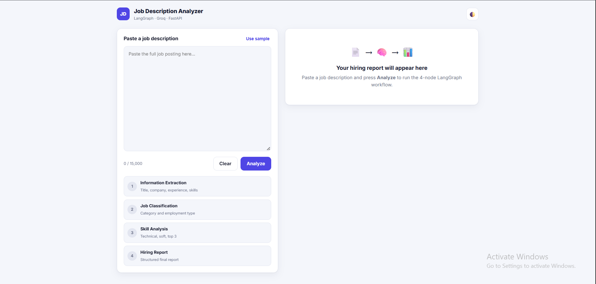
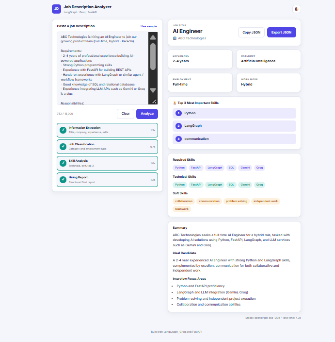
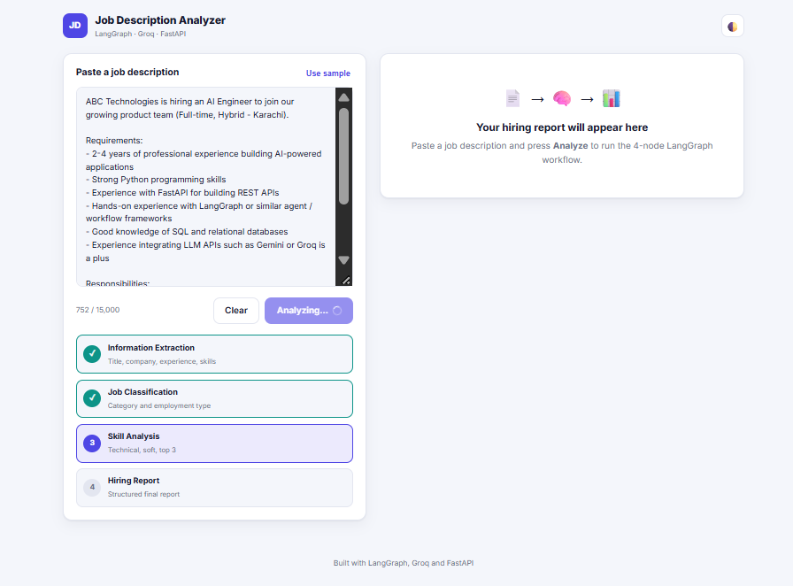
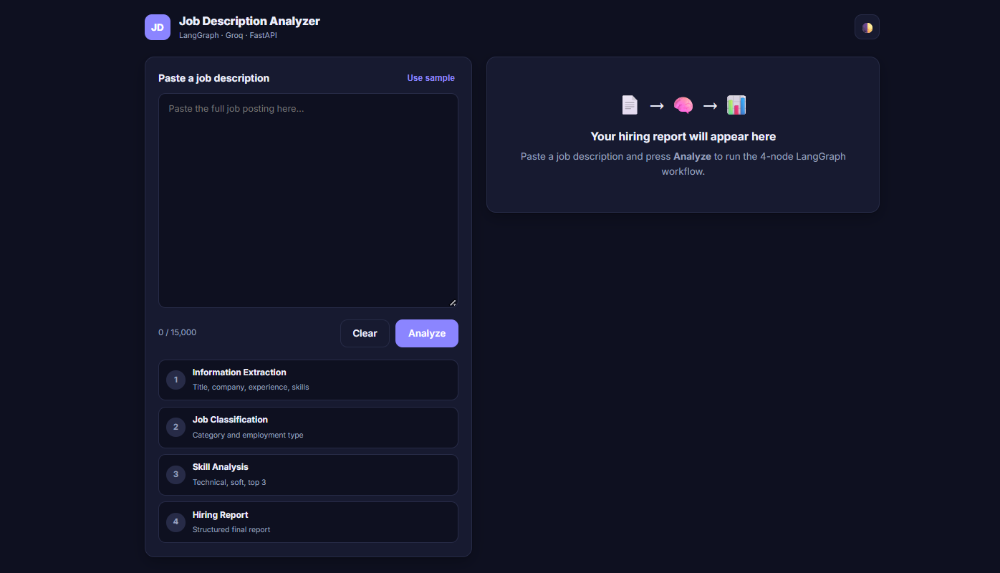

# AI Job Description Analyzer

An AI assistant that turns any **job description** into a **structured hiring report**.
The analysis runs as a 4-node **LangGraph** workflow powered by **Groq** (Llama 3.3 70B), served by a **FastAPI** backend with a clean **HTML/CSS/JS** frontend.

## Screenshots

### Home


### Hiring Report


### Analyzer


### Dark Mode


## Features

- 4-node LangGraph pipeline with shared state passed between nodes
- Extracts job title, company, experience and required skills
- Classifies job category, employment type and work mode
- Splits skills into technical / soft and ranks the **Top 3**
- Generates a final structured hiring report (summary, ideal candidate, interview focus)
- Skills displayed as colour-coded **tags**
- **Export report as JSON** (and copy to clipboard)
- Live pipeline progress with per-node timings
- Graceful handling of empty, too short, too long and non-job-description input
- Light / dark mode, responsive design

## Workflow

```
User Input (Job Description)
        |
Node 1: Information Extraction  -> title, company, experience, required skills
        |   (stops early if the text is not a job description)
Node 2: Job Classification      -> category, employment type, work mode
        |
Node 3: Skill Analysis          -> technical, soft, top 3 skills
        |
Node 4: Hiring Report           -> final structured report
        |
       END
```

## Tech Stack

Python · LangGraph · Groq API · Pydantic · FastAPI · HTML / CSS / JavaScript

## Project Structure

```
job-description-analyzer/
├── backend/
│   ├── app/
│   │   ├── config.py     # settings (.env)
│   │   ├── schemas.py    # Pydantic models
│   │   ├── prompts.py    # prompts for each node
│   │   ├── llm.py        # Groq wrapper (JSON mode + validation + retries)
│   │   ├── nodes.py      # the 4 LangGraph nodes + shared state
│   │   ├── graph.py      # LangGraph workflow definition
│   │   └── main.py       # FastAPI app (API + serves frontend)
│   ├── requirements.txt
│   └── .env.example
├── frontend/
│   ├── index.html
│   ├── style.css
│   └── script.js
└── docs/                 # report and presentation
```

## Setup

1. Get a free API key from https://console.groq.com/keys
2. Install and configure:

```bash
cd backend
python -m venv venv
venv\Scripts\activate        # Windows   (Mac/Linux: source venv/bin/activate)
pip install -r requirements.txt
copy .env.example .env       # Mac/Linux: cp .env.example .env
```

3. Open `backend/.env` and paste your key: `GROQ_API_KEY=...`
4. Run the app (from the `backend` folder):

```bash
uvicorn app.main:app --reload
```

5. Open http://127.0.0.1:8000 in your browser.

API docs are available at http://127.0.0.1:8000/docs

## API

`POST /api/analyze`

```json
{ "job_description": "We are hiring an AI Engineer ..." }
```

Returns the hiring report, per-node timings and the model name.
`GET /api/health` checks that the server and API key are configured.

## Example Output

```json
{
  "job_title": "AI Engineer",
  "company": "ABC Technologies",
  "experience": "2-4 years",
  "job_category": "Artificial Intelligence",
  "employment_type": "Full-time",
  "work_mode": "Hybrid",
  "technical_skills": ["Python", "FastAPI", "LangGraph", "SQL"],
  "soft_skills": ["Communication", "Teamwork", "Problem Solving"],
  "top_3_skills": ["Python", "LangGraph", "FastAPI"]
}
```
